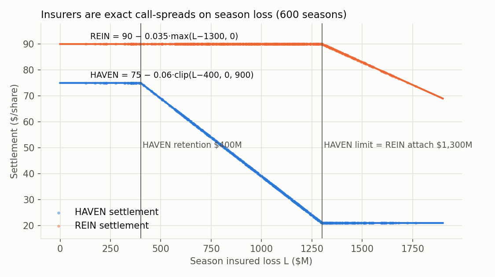
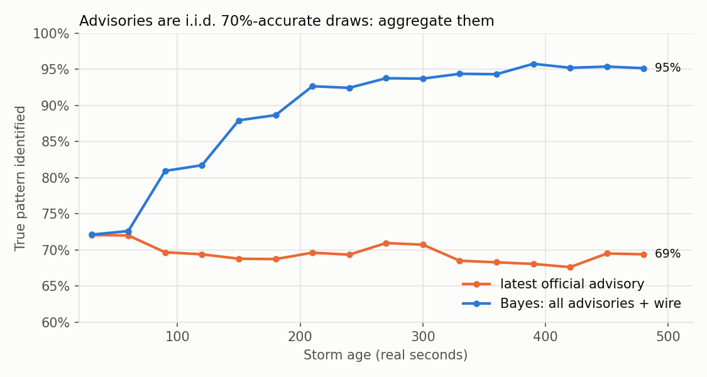
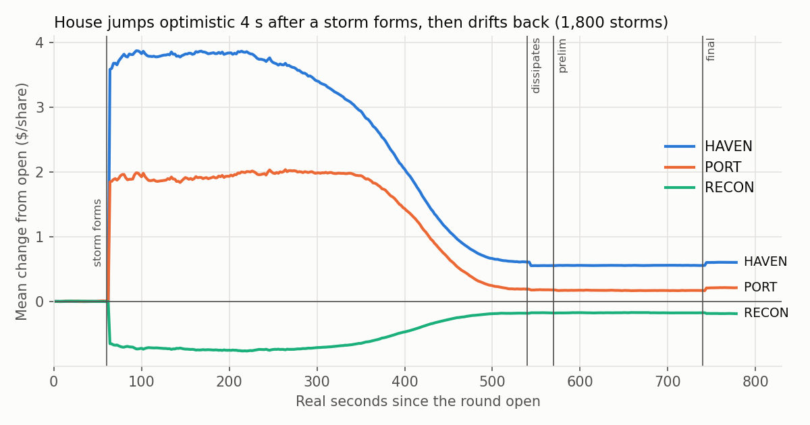

# Hurricane Season: research findings

All numbers are measured on the 600 research seasons (1,800 storms). Code is in `analysis/`
(rebuild everything with `/opt/anaconda3/bin/python3 -I analysis/build_all.py`, ~5 min).

## TL;DR

1. **Settlement values are an exact, known function of the damage.** I recovered every
   coefficient: the fit is within 1–2 cents on all 600 settlements. Insured losses, both insurer
   layers, all three rebuilders' concave curves and the outage costs are pinned down. See §2.
2. **The wind and damage physics are recovered too.** Wind = I·exp(−(d/r)²), sites close when
   wind > 0.35, and damage accrues only within 2 radii. A site-level damage model predicts each
   storm's damage % to ~28% log-error from the track alone. See §3.
3. **The house is near-efficient after a storm, but systematically wrong before and during it.**
   - **Formation jump.** About 4 s after `storm_formed`, the house reprices **optimistically**
     (PORT +1.84, HAVEN +3.59, rebuilders down) in 87–100% of storms. It then gives back about
     90% of that move by the end of the storm.
   - **Under-reaction in the storm.** Public information predicts the house's revision to the end
     of the storm with out-of-sample R² 0.4–0.6 at t ≈ 350–430 s.
   - **About 4 s lag at every repricing** (dissipation, prelim, final). ETFs lag their basket by
     a further 2 s, so 6 s in total.
   - **Certainty-equivalent pricing** at the open and between rounds. The house prices
     value(E[damage]) rather than E[value]: HAVEN is too cheap; RECON, MAT, GEN and REIN are too
     rich.
4. **Backtest of the in-storm model.** Out of sample, at house mid prices, it makes about
   **$4.0k per storm (about $12k per season) after an assumed 0.1% half-spread**, with 10% of
   seasons losing. A one-line "fade the formation jump" rule alone makes about $9.5k per season.

| Edge | When | Est. value (house mid, no competition) |
|---|---|---|
| In-storm nowcast vs house (GBM) | t = 70–490 s each round | ~$4.0k/storm at 0.1% cost |
| …of which the simple formation-fade rule | enter t ≈ 70–90, exit t ≈ 540 | ~$3.2k/storm, P(season<0) ≈ 0.2 |
| Snipe house repricing (stale for ~4 s) | t = 540, 570, 740 | ~$0.8–1.0k per event per round, theoretical |
| Formation front-run (stale 60→64 s) | t = 60 | ~$3.5k/storm, theoretical, depends on fills |
| ETF lag (6 s vs basket) | every repricing | ARCH ~$400, REBLD ~$200 per formation |
| Jensen bias (HAVEN long; RECON/MAT/GEN/REIN short) | open and between rounds | ~$1–1.5k/season |

The "theoretical" rows depend on fill quality inside a 4-second window and on other teams doing
the same thing. Size them on the testnet.

---

## 1. Data and loader (`load.py`)

`load.py` parses every season into tidy tables and caches them in `cache.pkl`: storms, storm
observations, official and wire advisories, impacts, reports, prices and settlements. The
packet's reference script reproduces: **official advisories name the true pattern 70% of the
time** (10,028 of 14,400).

Clock conventions: t = real seconds since 09:30.

| Event | Real time (s) |
|---|---|
| Storm forms | 60 |
| Advisories | 90, 150, …, 510 |
| Dissipation | 540 |
| Preliminary report | 570 |
| Final report | 740 |
| Close | 780 |

Storm `age` = t − 60.

## 2. The valuation model (`value.py`): exact

**Damage adds; it does not compound.** Per-storm `damage_pct` values are percentages of the
*original* value and sum to the season damage D. (Within a site, each storm destroys a fraction
of what remains, so the sum can never exceed 100%.)

```
PORT  = 100 − 55·D − 0.02·C        C = Σ_sites weight × real seconds with wind > 0.35 (season)
ISLE  =  60 − 38·D                 (no outage cost)
AQUA  =  35 − 20·D                 (no outage cost)
GRID  =  50 − 24·D − 0.05·C
FERRY =  25 −  5·D − 0.06·C        (mostly an outage stock)
L     = 900·D_PORT + 600·D_ISLE + 250·D_AQUA + 700·D_GRID + 120·D_FERRY   ($M)
HAVEN =  75 − 0.06·clip(L − 400, 0, 900)       retention $400M, limit $1,300M (floor 21)
REIN  =  90 − 0.035·max(L − 1300, 0)           attaches at $1,300M; no upper limit seen (max L = $1,766M)
RECON =  40 + 24·(1 − exp(−(900·D_PORT + 700·D_GRID + 120·D_FERRY)/1000))
MAT   =  28 + 14·(1 − exp(−L/1200))
GEN   =  32 + 18·(1 − exp(−C_GRID/120))
ARCH  = PORT + ISLE + 2·AQUA + GRID + 2·FERRY + HAVEN;   REBLD = 2·RECON + 2·MAT + GEN
```

Fit quality against settlements:

- rms error ≤ 2 cents on every stock
- ISLE, AQUA, RECON, MAT, HAVEN and REIN are exact to rounding
- PORT, GRID, FERRY and GEN carry ~1–2 cents from reconstructing closure time out of 2-second
  observations

Insured loss is exactly Σ (asset value × damage), with rms error $0.04M. Implications:

- The **final damage report determines every settlement exactly.**
- **HAVEN and REIN are option spreads on season loss** (`fig_insurance.png`). A storm moves
  HAVEN only while the season total is between $400M and $1,300M.
- The **outage terms are computable live from the storm track**, before any report. Neither
  damage report ever mentions them.



## 3. Wind, closures and damage (`wind.py`, `damage.py`)

- **Wind** at a site = intensity × exp(−(d/r)²).
- **Hurricane conditions / closure** occur while wind > 0.35. Both constants were found by
  minimizing settlement residuals. They also match the `impact` messages: at I = 1.15, closure
  starts at d/r ≈ 1.09.
- **Damage happens if and only if the storm passes within 2 radii.** The cutoff misclassifies 0
  of 1,800 storms. The per-storm site hazard is h = v_s·Σ I·exp(−(d/r)²)·dt (inside 2r), and
  each storm destroys 1 − e^(−h) of what remains.
- **Vulnerabilities v:** AQUA 0.015 (most fragile), GRID 0.0115, PORT 0.011, ISLE 0.009, FERRY
  0.0085. They are similar across sites within a company.
- **Residual noise** is lognormal on the hazard, about σ 0.33 per company per storm. It is
  **independent across companies** (cross-correlations ≈ 0) and smaller for big hits.
- **Depletion:** mean storm loss falls by round (round 1 $413M, round 2 $338M, round 3 $259M).
  Losses within a season are negatively correlated (−0.2).
- **Track data:** `track` messages are just the observations subsampled every 4 s, so they add
  no information. Intensity jitters ±0.05 and falls linearly to 0 over ages 420–480. Radius jumps
  by about 80 during eyewall replacement.

## 4. Information sources

- **Official advisories are independent 70%-accurate draws.** Accuracy is flat across advisory
  numbers 1–8, and P(right | previous right) = P(right | previous wrong) = 0.69. When an
  advisory is wrong it names another outlook uniformly (~6% each).
- **Wire rumors are 40% accurate.** When wrong they are uniform over the other five outlooks
  (12% each), so each rumor carries a likelihood ratio of about 3.3.
- **Bayesian aggregation** (`features.posterior`) identifies the pattern correctly:

  | Storm age | Accuracy |
  |---|---|
  | 90 s | 81% |
  | 150 s | 88% |
  | 210 s | 93% |
  | End of storm | 95% |

  The latest advisory alone stays at about 70%. Erratic flips (6.3% of storms, median flip age
  247 s) cap the achievable accuracy.
- **The cone and `hurricane_conditions` probabilities track the true path even when the outlook
  label is wrong.** Cone error at 120 s lead is 34 units vs 31.5 for right labels. The
  probabilities are well calibrated: 0.40 → 40%, 0.61 → 62%, 0.79 → 77%. Trade on the cone and
  the probabilities, never on the headline label.
- **The preliminary report** = final × e^ε, with ε ~ N(0, 0.31²). It is median-unbiased,
  independent per company, and independent of the track-model error. Combining the two as
  log(final) ≈ 0.46·log(prelim) + 0.54·log(track model) cuts the error to about 0.21. (The house
  already does this; see §5.)



## 5. How the house prices, and where it is wrong

`market.csv` is the house consensus price. It is a few seconds behind the news.

**What it gets right.** After the storm, the house is efficient relative to my damage model.
Regressing settlement on house(t = 546 or 600) plus my model gives house ≈ 1 and model ≈ 0. It
combines the prelim with the track correctly. It ignores wrong outlook labels and moves only a
few cents on wire rumors, except about +0.13 on PORT for "recurve" rumors.

**What it gets wrong:**

1. **The formation jump** (`fig_house_path.png`). At t = 64, the house moves:

   | Symbol | Jump | Share of storms in that direction |
   |---|---|---|
   | PORT | +1.84 | 87% |
   | HAVEN | +3.59 | 98% |
   | GRID | +0.96 | 99% |
   | ISLE | +0.72 | 95% |
   | FERRY | +0.54 | 94% |
   | AQUA | +0.52 | 95% |
   | RECON | −0.65 | 96% |
   | MAT | −0.39 | 99% |
   | GEN | −0.55 | 100% |

   It then drifts back about 90% by t = 540 and stays there to the close. The pre-storm price is
   about right; the live-storm repricing is too optimistic.
2. **In-storm under-reaction.** The house moves toward the eventual damage too slowly. The top
   predictors are the latest advisory's `hurricane_conditions` for the relevant island and the
   cone position. Example: at t = 240, when p(Cascadia) ≥ 0.98, PORT falls another $4.34 on
   average by t = 542.
3. **About 4 s lag at each repricing:** t = 544 (dissipation), 574 (prelim), 744 (final). The
   new price is predictable at the event time, with OOS R² of the jump 0.6 (dissipation), 0.75–0.9
   (prelim) and 0.7–0.86 (final). **ETF consensus = basket consensus lagged 6 s** (correlation
   0.98 at a 6 s lag, ~0 otherwise).
4. **Certainty-equivalent pricing.** The house's average open matches value(E[D]) rather than
   E[value(D)] for the nonlinear payoffs. Against my Monte Carlo expectation:

   | Symbol | House open | Plug-in value | True E[value] |
   |---|---|---|---|
   | HAVEN | 38.14 | 38.05 | 39.77 |
   | RECON | 52.57 | 52.82 | 52.08 |
   | MAT | 35.95 | 36.00 | 35.75 |
   | GEN | 40.24 | 40.30 | 40.01 |
   | REIN | 89.36 | 90.00 | 88.87 |

   The same bias persists at the round closes, shrinking as fewer storms remain: HAVEN is about
   1.4 too cheap after round 1 and about 0.7 after round 2. Linear stocks open about 0.2 low
   (slightly too much expected damage). Beyond this, the opening variation across seasons is pure
   noise (regression slope ≈ 0 on settlement), so fade the open toward E[settle].
5. **GEN.** My exact closure computation beats the house's GEN price (rmse $0.06 → $0.02).



### Live starting prices vs my expected settlement (`montecarlo.py`)

| | PORT | ISLE | AQUA | GRID | FERRY | RECON | MAT | GEN | HAVEN | REIN | ARCH | REBLD |
|---|---|---|---|---|---|---|---|---|---|---|---|---|
| live start | 72.48 | 50.26 | 27.33 | 36.41 | 17.91 | 52.38 | 35.81 | 40.30 | 39.55 | 89.36 | 289.20 | 216.68 |
| E[settle] (MC) | 72.08 | 50.05 | 27.19 | 36.53 | 18.19 | 52.08 | 35.75 | 40.01 | 39.77 | 88.87 | 289.18 | 215.66 |
| live − E | +0.40 | +0.21 | +0.14 | −0.12 | −0.28 | +0.30 | +0.06 | +0.30 | −0.22 | **+0.50** | +0.02 | **+1.02** |

At the open: short REIN, REBLD (or RECON and GEN), and PORT; buy FERRY and HAVEN. The edges are
small compared with the in-storm ones.

## 6. Playbook for one round

| Time (s) | Action |
|---|---|
| 0–60 | Fade the open toward E[settle] (Jensen table above). Pre-position for the formation jump if the testnet shows quotes stay stale until about 64 s. |
| 60 (`storm_formed`) | The house will mark islands and HAVEN up and rebuilders down at about 64 s, and ETFs at about 66 s. After the jump, **sell islands, HAVEN and REIN; buy RECON, MAT and GEN** (ETFs too, using their separate limits). |
| 90–490 | Run the nowcast: GBM on the physical gap (expected value − house), the Bayesian pattern posterior, advisory probabilities and the cone. Rebalance every ~20 s toward `limit × clip(pred/scale)`. **Stop adding risk after about 490 s**, when R² turns negative. |
| 540 / 570 / 740 | At each event, compute the house's next price and trade the 4 s gap (6 s on ETFs). At 740 the final report gives **exact** values for round 3. |
| Rounds 1–2 close | Hold the Jensen-bias positions (HAVEN long; RECON, MAT, GEN, REIN short) into the next round if spreads allow. |

## 7. Before the live event

- **Testnet:** measure the half-spread and depth of the house quotes. Check whether quotes really
  lag `storm_formed` and the reports by ~4 s, what "price protection" does, and how hard the
  market makers skew against inventory. The backtest stays positive up to about 0.2–0.4% cost
  per share traded; REIN turns negative above 0.1%.
- **Announcements** (live only; the house takes ~45 s to adjust). Parse the headline and change
  the matching constant in `value.py`:
  - asset values (`ASSET`), undamaged values (`V0`), damage or outage coefficients (`KD`, `KC`)
  - the HAVEN retention or limit, or a REIN cap
  - RECON's capacity scale (1000), MAT's (1200), GEN's (120)

  Then trade the gap before the house catches up.
- **Rate limits:** 60 order actions per minute per key, 180 per team. Rebalancing 10 symbols
  every 20 s with cancel and replace needs about 60 per minute, so spread the work over 2–3 keys.
  Resting orders count toward position limits.
- **ETF create/redeem** is free and immediate at marks. Use it to convert ETF positions into
  stock positions (or back) when one leg's limit binds.

## 8. Robustness and dead ends

How stable each edge is: P(a full 3-round season makes money), and the mean $ per season in six
independent blocks of 100 seasons. Costs are an assumed 0.1% half-spread, at house prices.

| Edge | Mean $/season | P(season > 0) | Six 100-season blocks |
|---|---|---|---|
| In-storm model (out of sample) | 12,184 | 0.90 | 13.3k, 12.4k, 10.4k, 12.6k, 12.8k, 11.7k |
| Formation fade (simple rule) | 8,402 | 0.76 | 9.8k, 7.2k, 6.9k, 8.2k, 10.0k, 8.4k |
| …excluding PORT/HAVEN/REIN | 5,159 | 0.77 | all six positive |
| Round-3 final-report snipe (if filled pre-jump) | 928 | 1.00 | all six positive |
| Jensen hold, open → settlement | 989 | 0.47 | one negative block; positive on average but a coin flip per season |

Checked and found **no edge**:

- Price gaps between rounds: only a few cents of quote noise.
- Noise in the round-2 and round-3 opens.
- Fading wire rumors.
- Short-horizon momentum.
- Beating the house on post-storm damage estimates.
- Trajectory-history features: zero added R², because the cone and probabilities already encode
  the path.
- An AQUA shelter effect.
- State-dependent mispricing between rounds, beyond the Jensen bias.

## 9. Files

| File | Contents |
|---|---|
| `load.py` | Parses all seasons into DataFrames (`cache.pkl`) |
| `value.py` | The exact settlement model |
| `wind.py` | Wind and closure model, per-site closure features |
| `damage.py` | Site-level damage model (fit stored in `damage_params.npy`) |
| `montecarlo.py` | E[settlement \| season state] by resampling the 1,800 historical storms |
| `features.py` | Bayesian pattern posterior; early feature grid |
| `nowcast.py` | Live-computable physical nowcast: locked-in damage plus cone-projected damage, plus future storms |
| `backtest.py` | Season-grouped CV GBM and trading simulation |
| `r3frame.py` | Round-3 house-efficiency checks |
| `figures.py` | Figures |
| `build_all.py` | Rebuilds everything |
